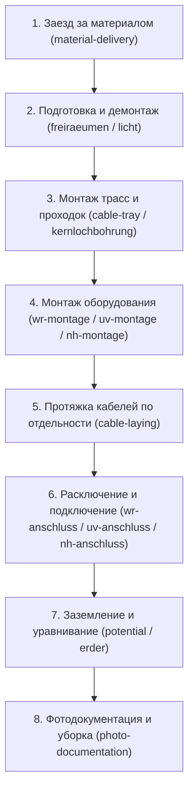

# DLC Montage: Правила заполнения ежедневных отчётов (Daily Report Entry Protocol)

Настоящий навык регламентирует строгое пошаговое заполнение ежедневных отчётов (`MbgDailyReport`) и строк работ (`MbgWorkEntry`).

---

## 0. Начало работы: короткий опрос и проверка остатка

Сначала извлечь уже известные сведения из текущего разговора и базы. Спрашивать только недостающее, одним коротким блоком; не заставлять пользователя повторять сказанное и не требовать точного хронометража каждой операции, если он просит предварительную раскладку.

Уточнить:
- Дату и объект: полный адрес/подъезд, какой из недавно начатых объектов имеется в виду. «Сегодня» определять по часовому поясу пользователя.
- Кто работал; кто делал трассы, прокладку каждого кабеля, расключение, заземлитель и уравнивание потенциалов. При фразе «я делал» установить исполнителя из контекста, иначе спросить.
- Начало и конец дня, длительность и начало обеда. Если дан выбор 12:00 или 12:30, выбрать один вариант и явно показать его в предварительном расписании. Не превращать 08:00–16:00 или получасовой обед в постоянные значения.
- Работал ли кто-то на другом объекте: кто, где, в какой период или сколько времени; включить это в общий день человека без пересечений и двойного учёта обеда.
- Что фактически завершено, что осталось; типы, сечения, количество отдельных кабелей, маршруты и объёмы, если они не подтверждены планом или отличаются от него.

Пример короткого запроса недостающих сведений: «Кто сегодня работал и кто делал трассы, кабели, подключения и заземление? Во сколько начали и закончили, когда обед? Кто-то работал на другом подъезде? Какие кабели или объёмы отличаются от плана?» Из примера убрать вопросы, ответы на которые уже известны.

До раскладки прочитать план SiteWorkItem, последние отчёты и актуальные принятые объёмы по каждому объекту. Показать оставшийся список с учётом уже записанных работ; не повторять вчерашний монтаж оборудования. Если принятый отчёт исключён из расчёта из-за missing_current_accepted_snapshot, явно сообщить об этом: ручная сверка строк пригодна для предварительного списка, но не заменяет подтверждённый остаток. Не исправлять исторические снимки в рамках составления предварительного расписания.

## 0.1. Полный день в пределах заложенного времени

В этом рабочем процессе заложенное в базе время служит верхним пределом позиции: меньше допустимо, больше — нет. Читать актуальные нормы и правила расчёта из каталога, не воспроизводить числа по памяти.

- Проверять фактические **человеко-часы**, а не только длительность строки: длительность × число участников. Час совместной работы двоих расходует два человеко-часа.
- Для fixed учитывать normative_hours × quantity и underconstruction_hours только при фактическом наличии соответствующей конструкции. Для cable использовать норму выбранного CableType и число расчётных участков; для connection — базовую норму и подтверждённое число стандартных/тяжёлых подключений по действующему расчёту. Не добавлять подключения или объёмы ради увеличения предела.
- У правил actual/zero нет фиксированного предела из значения normative_hours=0. Не трактовать ноль как запрет времени и не добавлять такие работы для искусственного заполнения дня.
- Разбитые обедом строки одной операции проверять **в сумме** против её общего предела. Не выдавать каждой половине полный лимит заново.
- Если пользователь просит расписать полный день без поминутной истории, составить явно предварительную оценку по фактически названным работам. Заполнить рабочие интервалы каждого человека с вычетом обеда и времени на других объектах; не выдумывать дополнительные работы, ожидание, уборку или фотографии для закрытия пробелов.
- Трассы можно вести последовательно WR → UV → NH/HV, если это соответствует данному объекту и словам пользователя. Другой монтажник может прокладывать кабель по уже готовому участку, пока первый делает следующий. Не ждать завершения всех трасс, но не ставить кабель раньше готовности его участка.
- Если назначение неизвестно, спросить, кому отнести работу; явно отделять предложенное распределение от подтверждённого. Привычное распределение из текущего разговора можно использовать для предварительного варианта, но не считать его постоянным правилом для всех бригад.
- Показать таблицы по людям: время, объект, отдельная операция, фактическое время/предел. Подвести часы каждого человека и каждого объекта; проверить 15-минутную сетку, отсутствие пересечений, необъяснённых пробелов и превышений.
- Если полный день не помещается в доступные работы и их пределы, показать конкретный дефицит или превышение и спросить о фактических обстоятельствах. Не подгонять объёмы и состав работ.

Предварительный просмотр не является сохранением или принятием отчёта. Записывать данные только в пределах поручения пользователя; не менять план, статусы и исторические отчёты лишь потому, что показан вариант расписания.

## 0.2. Только внутренний учёт

Если пользователь просит сохранить работу и часы внутри DLC, но не включать её в счёт, сдельную ведомость, акт приёмки или кабинет заказчика, использовать признак строки MbgWorkEntry.internal_only («Только внутренний учёт»). Нулевая цена и текст «без оплаты» сами по себе строку не исключают. Не менять общий каталог ради исключения отдельной записи.

Сохранять фактических участников, время и адреса работ; внутренние строки остаются в дневном отчёте, истории проекта и табеле. Признак переносится в принятую ревизию; старые снимки без него считаются обычными строками. При исправлении принятого отчёта использовать сервис с причиной и новой ревизией, не переписывать старый снимок. После сохранения проверять сохранность часов и отсутствие отмеченных строк в клиентских/расчётных проекциях. Ранее сформированные файлы не редактировать: для актуального документа нужна новая выгрузка.

## 0.3. Кабели и заземление: не угадывать параметры

Сечения 5×10, 5×16, 5×25 и PE 1×16 в примерах ниже не являются значениями по умолчанию. Брать сечение и маршрут из подтверждённых данных конкретного объекта; при расхождении с планом уточнить у пользователя. Мощность инвертора сама по себе не подтверждает фактически проложенный кабель.

«Штифт» в контексте этих работ — глубинный заземлитель (Tiefenerder). Разделять его устройство, прокладку проводника и подключение к HPAS. Не считать potential («монтаж новой шины») синонимом прокладки проводника или подключения к существующей шине.

Проводники UV → HPAS, NH/SPD → HPAS и заземлитель → HPAS — разные физические линии. Проверить их наличие в плане и не объединять разные кабели. Если сечение неизвестно, в предварительном описании допустимо «проводник уравнивания потенциалов» с явной отметкой неизвестного сечения; нельзя подставлять PE 1×16 и его предел без подтверждения. Отсутствующую плановую позицию обозначить отдельно, не привязывать её к другой линии и не создавать автоматически без поручения.

---

## 1. Главный антипаттерн (Строгий запрет на «ленивые котлеты»)

### ❌ ЗАПРЕЩЕНО:
- Записывать многочасовые агрегированные интервалы ни о чём (например, *«07:00 – 12:00: Монтаж трассы и прокладка кабелей»*).
- Записывать несколько разных кабелей или работ в одну строку отчёта.
- Нарушать хронологическую технологическую последовательность (например, ставить подключение/расключение раньше монтажа трассы и протяжки кабеля).
- Использовать свободный неструктурированный текст вместо позиций каталога `work_catalog`.

### ✅ ОБЯЗАТЕЛЬНО:
- Полный рабочий день бригады разбивается на **дискретные технологические кванты** по **15-минутной сетке** (`minute % 15 == 0`, `second == 0`).
- **1 физическая операция = 1 отдельная запись `MbgWorkEntry`**.
- Каждая запись ссылается на конкретный элемент `work_catalog.WorkType`, `CableRoute`, `CableType`.

---

## 2. Физическая технологическая цепочка электромонтажа (AC)

Любой рабочий день на AC-объекте подчиняется естественной инженерной последовательности:

> **Правило здравого смысла:** Нельзя подключить щит или инвертор до того, как они смонтированы на стену, и до того, как к ним протянут соответствующий кабель!

---

## 3. Правило параллельной работы бригады (Параллельные потоки монтажников)

Когда монтажники на объекте работают над разными задачами одновременно:
- **ОБЯЗАТЕЛЬНО** разделять строки работ по конкретным исполнителям (`participants`)!
- Не писать бригаду скопом туда, где операцию выполнял один человек.
- Допускаются параллельные строки с одинаковым интервалом времени (например, с 14:00 до 15:30 Монтажник А монтирует трассу, а Монтажник Б прокладывает кабели), если их участники не пересекаются.
- У одного монтажника интервалы **не могут пересекаться** во времени.

---

## 4. Правило кабельных линий: каждый кабель — отдельная строка

Если за рабочий отрезок времени бригадой прокладывалось несколько кабелей, они **никогда не объединяются**:

1. **Силовой ввод / магистраль** (`power-5x16`, `power-5x25` или `power-5x35`):
   - Отдельная запись `MbgWorkEntry` со своей трассой (`route` = `nh-new-hv` или `uv-nh-new`) и метрами.
2. **Линия инвертора** (`power-5x10`):
   - Отдельная запись `MbgWorkEntry` (`route` = `wr-uv`).
3. **Кабель заземления / уравнивания потенциалов** (`pe-1x16`):
   - Отдельная запись `MbgWorkEntry` (`route` = `hpas-new-old`).
4. **Кабель связи / управления** (`data` / `control-7x1-5`):
   - Отдельная запись `MbgWorkEntry` (`route` = `wr-uv` или `uv-key-switch`).

У каждой строки:
- Своё точное время начала и конца (`starts_at`, `ends_at`);
- Свой `cable_type`;
- Свой `route`;
- Свой физический объём и корректные единицы: метраж не подменяет `quantity`, если поле хранит число расчётных участков (`ten_meters` / `five_meters`);
- Участники (`participants`), которые фактически тянули этот кабель.

---

## 4. Специфика отдельных типов работ

### Логистика и материалы:
* **Заезд и забор материала (`material-delivery`)**:
  - Всегда отдельная строка в начале или середине дня.
  - Оплата шефу — фиксированная паушаль 50,00 €, но часы участников пишутся точно для табеля.
* **Разгрузка на объекте (`material-unloading`)**:
  - Отдельная строка при необходимости (0,00 € в сдельщине, часы в табель).

### Обед и перерывы:
* **`Mittagspause`**:
  - `is_break = True`. Время перерыва (обычно 30 или 45 минут) не оплачивается и не задваивает рабочие часы.

### Подключения (Anschluss):
* `wr-anschluss` — подключение инвертора.
* `uv-anschluss` — подключение шкафа UV-PV.
* `nh-anschluss` — подключение распределителя NH.
* Оформляются **после** завершения прокладки кабелей к соответствующему щиту/прибору.

---

## 5. Чек-лист проверки перед сохранением отчёта

Перед фиксацией отчёта за день агент обязан проверить:
1. [ ] Нет ли интервалов длиннее 2–3 часов без смены операции?
2. [ ] Не объединены ли разные кабели в одну строку?
3. [ ] Идёт ли протяжка кабелей строго **до** их расключения?
4. [ ] Кратно ли всё время 15 минутам (`:00`, `:15`, `:30`, `:45`)?
5. [ ] Нет ли пересечений по времени у одного и того же монтажника (`participants`)?
6. [ ] Указан ли правильный `AcObject` (Standort) и привязанные `SiteWorkItem` (если ведутся проектные остатки)?

7. [ ] Фактические человеко-часы каждой операции, включая части до/после обеда, не превышают предел из базы?
8. [ ] Полный день каждого участника сходится с обедом и работами на других объектах без двойного учёта?
9. [ ] Сечения, маршруты и исполнители подтверждены; предположения и отсутствующие позиции явно отмечены?

## Конфигурация конкретного объекта и исправление исторических привязок

- Не превращать весь каталог возможных работ в обязательный план каждого Standort.
  Включать только подтверждённый состав работ данного адреса. Монтаж уже существующего
  оборудования и работы, которых на объекте нет, не являются открытыми обязательствами DLC.
- По прямому правилу владельца: при UV-PV 25 или 30 кВт и одном Wechselrichter
  Steuerleitung 7×1,5 мм² к Schlüsselschalter не предусматривается. Не добавлять этот
  кабель и связанные исключительно с ним проходку/защитную трубу. Для применения
  правила использовать подтверждённую мощность и число инверторов, а не угадывать их.
- Новые отчёты по-прежнему строго дискретны: один физический кабель или операция — одна строка.
  Историческую общую строку нельзя использовать как разрешение снова агрегировать работы.
- Если принятый отчёт запрещено менять, его общие строки расшифровываются для прогресса
  плана через reconcile_plan_entry. Сохранять общий объём часов исходной строки, не менять
  отчёт, снимки, ставки, сумму или приёмку заказчика. Явно указать основание каждого участка.
- Если работа прямо подтверждена владельцем, но отдельной строки в отчёте нет, не придумывать
  её дату, исполнителя и часы: clarify_completed_work_item хранит отдельное уточнение плана
  с причиной и аудитом. Это не новая строка принятого отчёта и не финансовое начисление.
